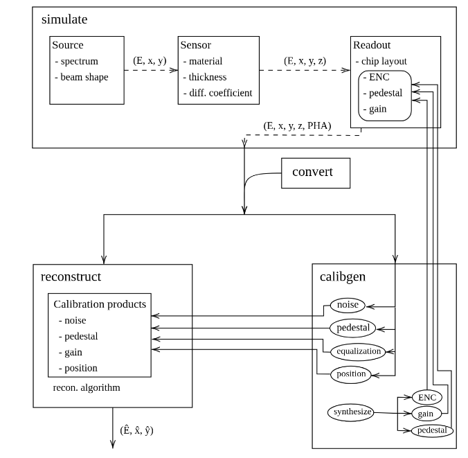

.. _overview:

Overview
========

``hexsample`` is a Python package for the simulation and analysis of solid-state
hybrid detectors with hexagonal pixel sampling, providing the necessary
facilities to simulate, reconstruct and display data.

Command-line interface
----------------------

Once you have installed the package, the command-line interface provides access
to all the facilities at the most basic level.

.. program-output:: hexsample --help
   :prompt:

(You can also try ``hexsample <subcommand> --help`` to get help on specific
sub-commands.)

Tasks and pipelines
-------------------

At a higher level, the package is organized around a set of tasks implemented
in the :mod:`~hexsample.tasks` module. Most tasks are exposed through
corresponding command-line subcommands and wrapped by functions in the
:mod:`~hexsample.pipeline` module.

.. seealso::

   :mod:`~hexsample.tasks`
   :mod:`~hexsample.pipeline`

The main difference between the two modules lies in how function arguments are
handled. Functions in the :mod:`~hexsample.tasks` module have explicit,
documented signatures. When building a simulation or analysis workflow
programmatically, these functions should normally be preferred because they
allow invalid or misspelled argument names to be detected immediately.

Functions in the :mod:`~hexsample.pipeline` module, on the other hand, are
driven entirely by keyword arguments. They filter the supplied arguments and
ignore those that are not recognized by the corresponding task. These wrappers
are primarily intended for use by the command-line interface, where argument
validation is performed by :mod:`argparse`.

The relationships between the main processing stages and their associated
command-line tasks are summarized in the following diagram. The arrows
indicate the flow of data and calibration products throughout the analysis
workflow.

   Overview of the main analysis workflow and the dependencies between
   simulation, calibration, and event reconstruction.